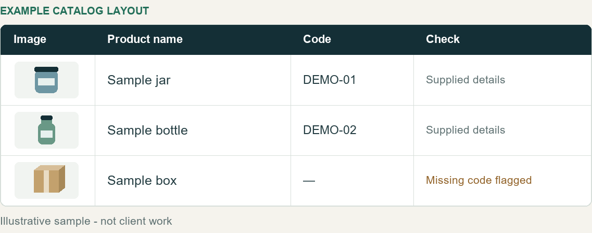

# 商品图片整理成目录：字段清单与核对方法

2026年11月18日 · AI辅助整理的原创说明文

商品目录看起来是一张表，实际要解决的是三件事：图片对应哪件商品、文字依据从哪里来、哪些信息还不能确定。把这些关系记清楚，比先把表格做漂亮更重要。

这篇短文介绍一套可用自己的合法图片练习的整理方法。配图为本项目制作的几何图形和表格示意，不含客户资料，也不是实际Excel截图或客户交付案例。

配图截取自本项目自制封面的表格部分，保留“EXAMPLE CATALOG LAYOUT”和“Illustrative sample - not client work”两个示意标签。

## 先把输入放到一起

先准备一个原图文件夹，再准备一份已知信息清单。每张图片保留原文件名；如果需要排序，另外增加“图片序号”，不要为了方便排序把临时序号当成商品正式编号。

正式名称、型号、编号和规格应来自有权使用的产品资料或提供者确认。图片上看不清的字、不确定的单位，以及凭外形猜到的用途，都不能直接写成已确认事实。整理别人的资料时，还应先确认图片使用权，以及对方能否接受AI辅助处理；本方法不要求把图片上传到任何外部服务。

## 从一组小字段开始

先建立能追溯的对应关系，再按真实需要增加字段。

| 字段 | 填什么 | 不确定时怎么处理 |
| --- | --- | --- |
| 图片序号 | 本次整理用的顺序，如图01、图02 | 明确它只是工作标识，不是型号 |
| 原图片文件名 | 原始文件的完整名称 | 不擅自重命名后丢掉原对应关系 |
| 商品图 | 能辨认主体的预览图，或指向本地原图的标识 | 模糊、缺图或无法对应时写进异常列 |
| 正式商品名称 | 资料提供者给出的名称 | 留空，并注明“未提供正式名称” |
| 正式编号或型号 | 有依据的编号或型号 | 留空，并注明“缺少编号”或“编号待确认” |
| 状态与异常 | 缺项、重复、冲突及需要确认的问题 | 写清问题和依据，不用一个“待定”掩盖原因 |

规格和单位不是每份目录都必须有。只有确实需要、而且拿到可靠资料时再添加；例如长度必须保留原单位，不能看到一个数字就自行补成毫米。

## 用空白和异常列保存不确定性

配图里的罐、瓶、纸盒都是自行绘制的符号。“Sample jar”“Sample bottle”和DEMO编号都是示意文字。纸盒没有编号，所以图中用横线表示缺失；在实际数据字段里，可以留空，并在异常列说明原因。

三种常见情况可以这样处理：

- **没有提供：** 正式名称或编号留空，异常写“未提供”，不要用临时猜测补齐。
- **看不清：** 保留原图，异常写清哪一处无法辨认，等待更清楚的原图或文字资料。
- **资料冲突：** 例如两份资料给出不同尺寸，记录各自文件名和原值，标记“待确认”，不要选一个顺眼的值，也不要取平均数。

记录“未提供”和记录“0”含义不同。只有原始资料确实写0，或实际测量结果为0，才能把它当数值0。

## 从文件夹到表格，做一轮可复查的核对

1. **先数清输入。** 记录原图数量，逐张建立图片序号和文件名。相似图片可能是同一商品的不同角度，不要只凭外形删除所谓重复项。
2. **再对对应关系。** 一行对应一件商品还是一张图片，先选清楚并写在表格说明中；不能一半按商品、一半按图片，却让读者自行猜测。
3. **逐项对文字。** 名称、编号、规格和单位与来源资料逐项核对。保留前导零，避免把正式编号自动变成数字后丢失信息。
4. **单独看异常。** 回查所有空字段、重复编号和冲突值，确认每个问题都有说明。异常清单是交付信息的一部分，不是整理失败后应隐藏的内容。
5. **最后检查可读性。** 如果使用Excel，把图片放到对应行，检查缩略图、列宽和排序是否仍正确；在实际使用的软件版本中打开确认。本文配图不能替代这一步，也没有证明某份工作簿已经通过实机验收。

想自己练习，可以选三张有权使用的图片，先只填图片序号、原文件名和已知名称。故意把没有依据的一项留空，再写一条明确的异常说明。完成后，请另一个人只根据表格找到对应原图，看看是否需要猜测；如果需要，继续补足对应关系。

## 制作来源与真实限制

本文自行组织字段、步骤和说明，文字与自制示意图使用了AI辅助。使用时仍需逐项核对原图、产品名称、编号和规格。

本文只说明资料整理方法。配图是排版示意，不提供产品实测数据；商品规格、性能及图片使用权需另行确认。

创作主页：[爱发电](https://ifdian.net/a/notesandtables)。
